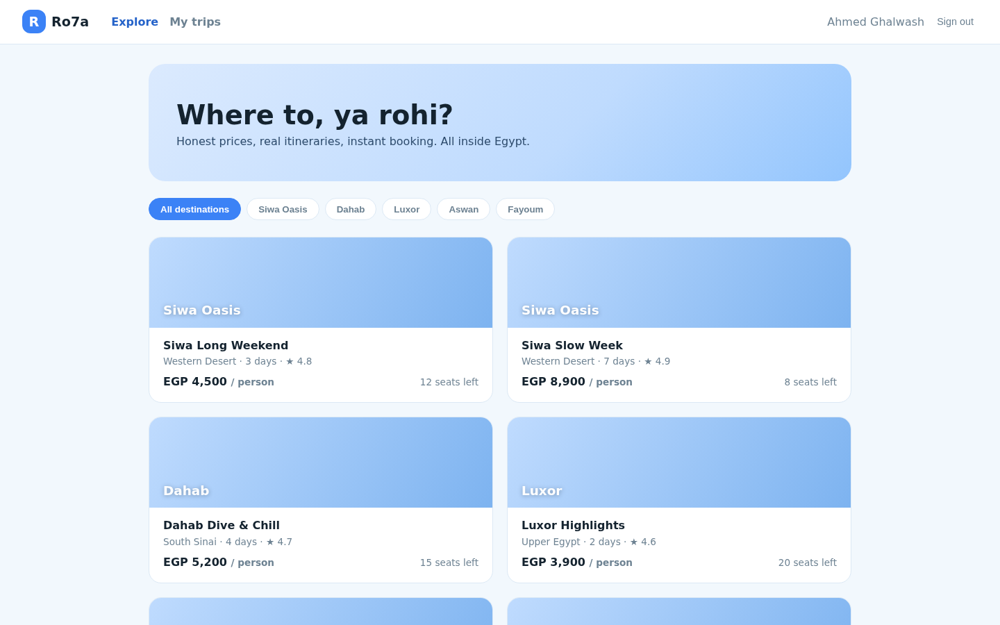
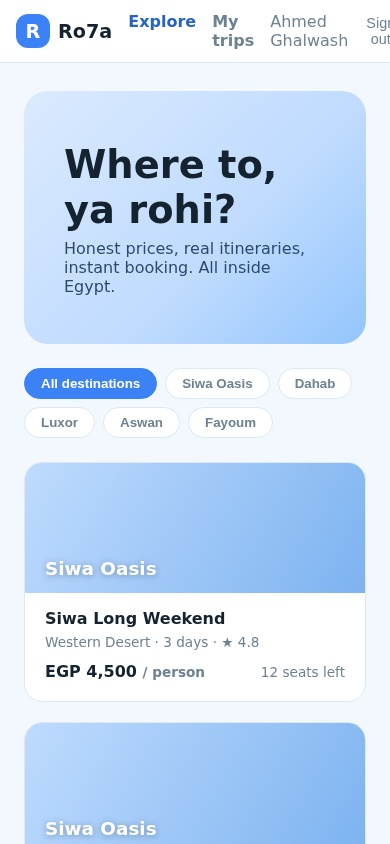
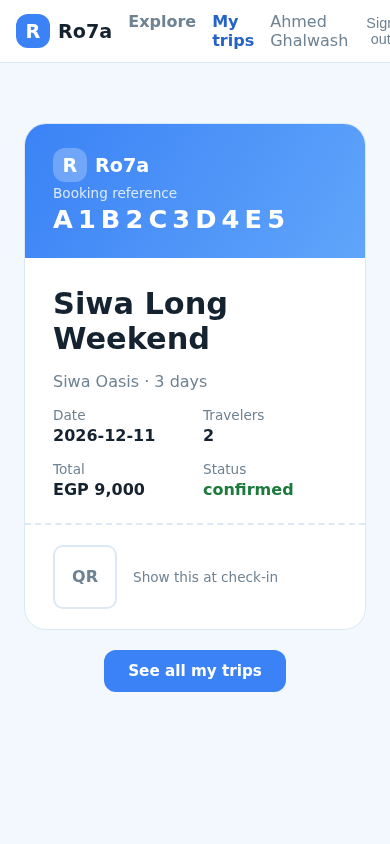

# Ro7a - Egypt Travel Booking

A booking app for discovering trips inside Egypt with honest prices and real itineraries.

Full-stack concept application: a **React 18** single-page client, a **PHP 8 REST API**
(framework-free, PDO with prepared statements) and a **MySQL** database.

## Features

- Destination and trip discovery with filters and ratings
- Day-by-day itineraries stored relationally, not as blobs
- Transactional booking with a guarded seat decrement (no overbooking)
- Server-computed totals and unique, URL-safe booking references
- Ticket-style confirmation page

## Tech stack

| Layer | Tech |
| --- | --- |
| Front end | React 18, Vite, React Router |
| Back end | PHP 8.1+, PDO (native prepared statements), PHP sessions |
| Database | MySQL 8 (InnoDB, foreign keys, transactions) |

## Screenshots

| Screen | Desktop | Mobile |
| --- | --- | --- |
| Explore trips |  |  |
| Trip detail with itinerary and booking |  |  |
| Ticket-style booking confirmation |  |  |
| My bookings |  |  |

## Source code

The full source code for this project - the React client, the PHP REST API, and the
database schema with seed data - is kept in a **private repository**.

It is available on request: reach out through my
[GitHub profile](https://github.com/ahmed-ghalwash) and I will be happy to share it.
