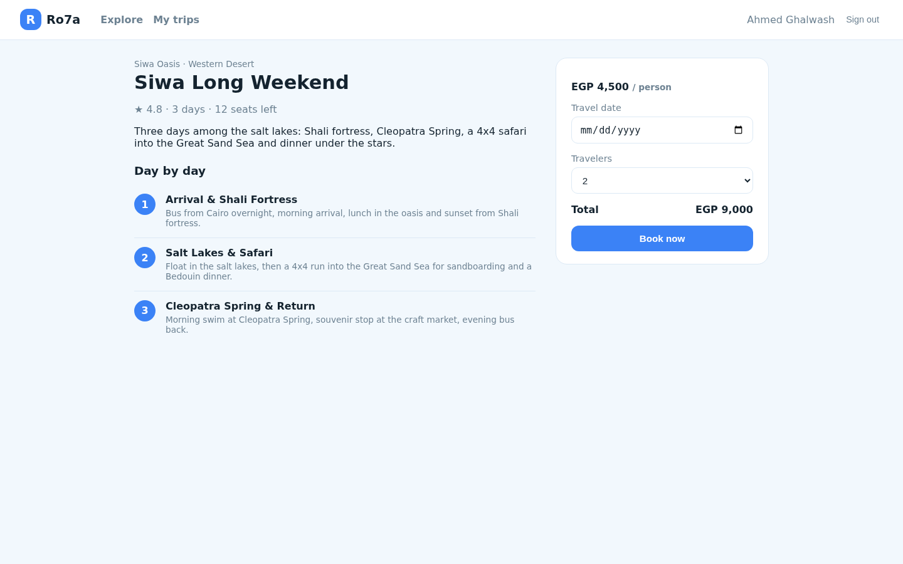
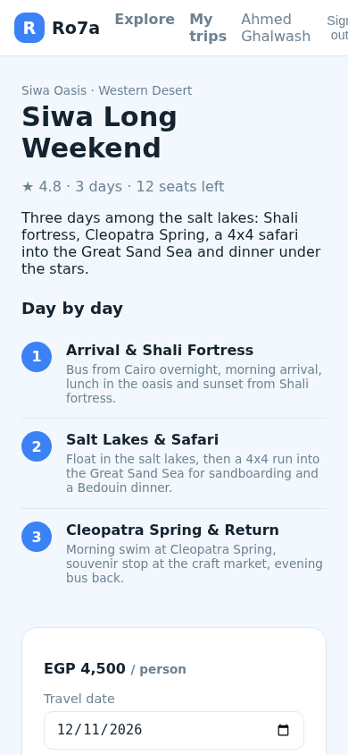
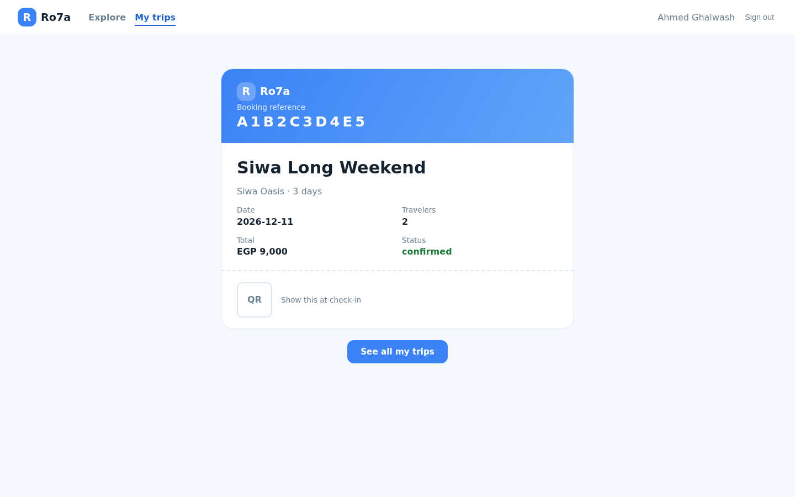
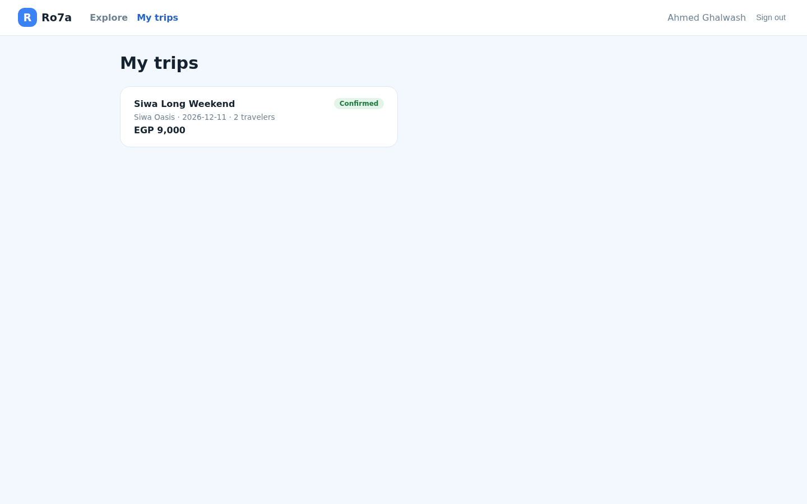
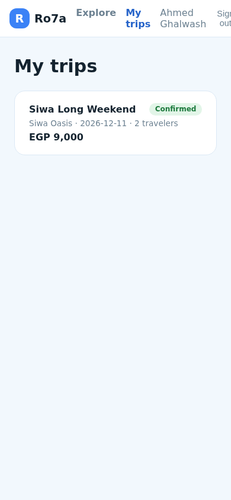

# Ro7a - Egypt Travel Booking

A booking app for discovering trips inside Egypt with honest prices and real itineraries.

Full-stack concept application: a **React 18** single-page client, a **PHP 8 REST API**
(framework-free, PDO with prepared statements) and a **MySQL** database.

## Features

- Destination and trip discovery with filters and ratings
- Day-by-day itineraries stored relationally, not as blobs
- Transactional booking with a guarded seat decrement (no overbooking)
- Server-computed totals and unique, URL-safe booking references
- Ticket-style confirmation page

## Interface

The client ships a hand-written motion layer - CSS keyframes plus a few small React
helpers, no animation library: staged entrances with per-card stagger, hover lift and
cover zoom, numbers that count up, charts that draw themselves, an animated seat map and
boarding pass, confetti only on real success states, and shimmering skeletons while a
request is in flight. All of it switches off under `prefers-reduced-motion: reduce`.

## Tech stack

| Layer | Tech |
| --- | --- |
| Front end | React 18, Vite, React Router |
| Back end | PHP 8.1+, PDO (native prepared statements), PHP sessions |
| Database | MySQL 8 (InnoDB, foreign keys, transactions) |

## Screenshots

| Screen | Desktop | Mobile |
| --- | --- | --- |
| Explore trips |  |  |
| Trip detail with itinerary and booking |  |  |
| Ticket-style booking confirmation |  |  |
| My bookings |  |  |

## Engineering

- **API test suite:** 19 end-to-end tests (71 assertions) that start the real PHP front controller and drive it over HTTP: registration and sessions, validation, ownership checks, booking totals, validation, overbooking protection, privacy and cancellation with the 2 day rule. They run against SQLite so no database server is needed; real MySQL is covered by the smoke test below.
- **Docker Compose:** MySQL 8.4, the PHP API and nginx serving the React client start with one command.
- **CI (GitHub Actions):** PHP lint and tests on PHP 8.3, the client production build, and a Docker smoke test that boots the whole stack and checks health, registration and the session endpoint against real MySQL.
- **Endpoints added in this round:** `POST /api/bookings/{id}/cancel` (seats return to the trip) and `GET /api/health`.

## Source code

The full source code for this project - the React client, the PHP REST API, and the
database schema with seed data - is kept in a **private repository**.

It is available on request: reach out through my
[GitHub profile](https://github.com/ahmed-ghalwash) and I will be happy to share it.
